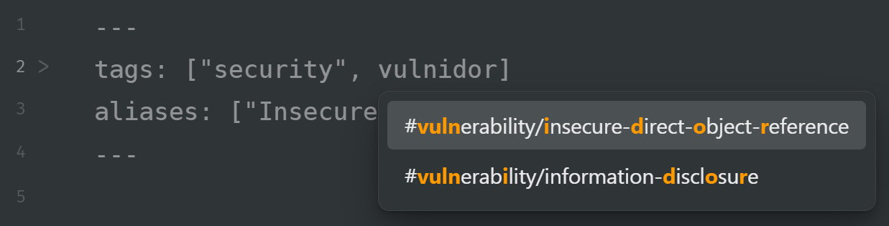

# Fuzzytag

---

Basado en el complemento Frontmatter Tag Suggest
https://github.com/jmilldotdev/obsidian-frontmatter-tag-suggest

Este complemento se ha creado porque la búsqueda difusa modificaría la funcionalidad del complemento original, lo cual quizás no sea deseable para todos.
Gracias al desarrollador del complemento original por la inspiración y la base para crear este complemento.

## Problemas conocidos

La implementación improvisada del resaltado en las sugerencias significa que las etiquetas con caracteres especiales (`<` o `>`) podrían fallar. No dudes en enviar un PR si esto no funciona con tu flujo de trabajo.
